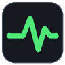
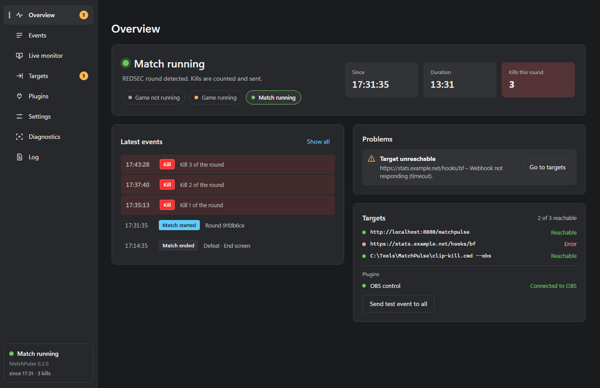
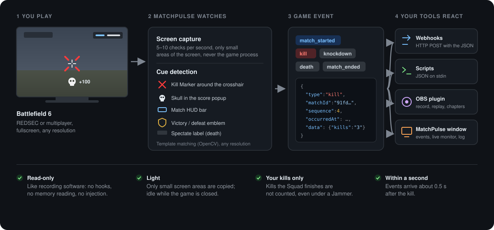
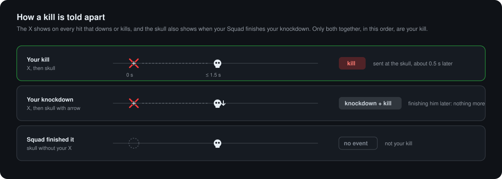
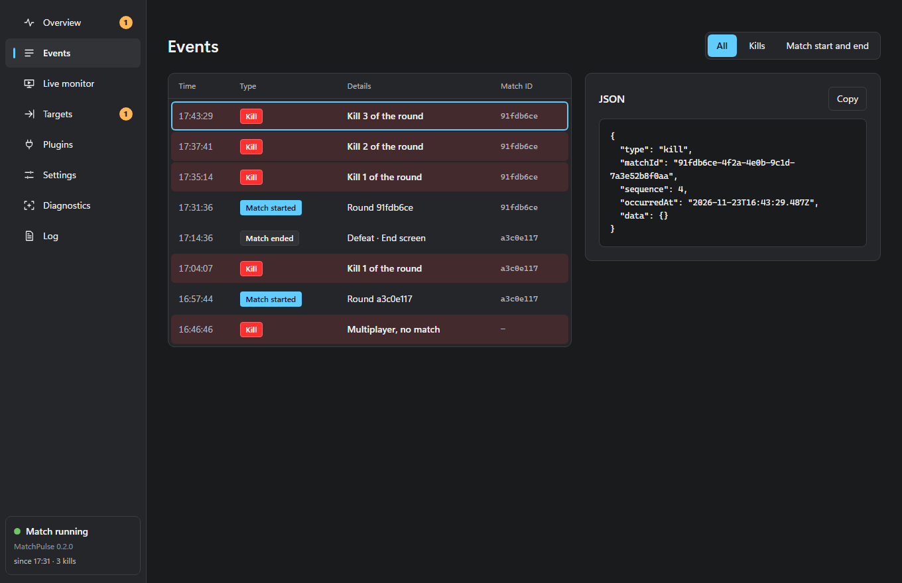
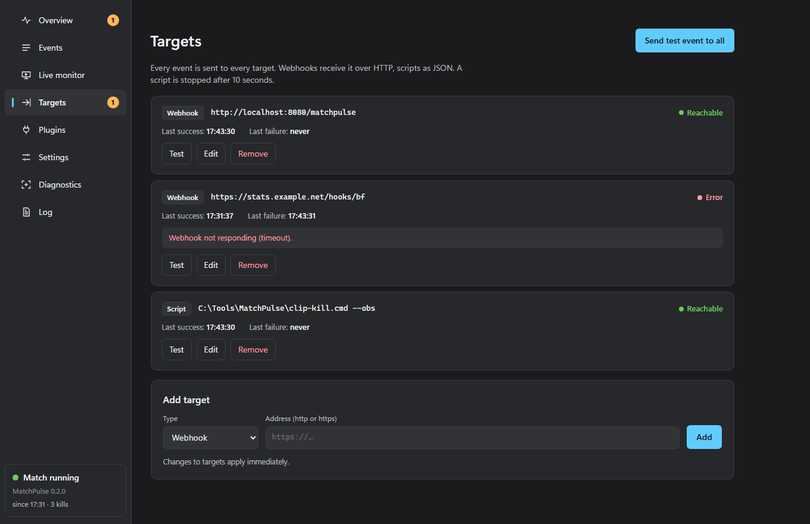
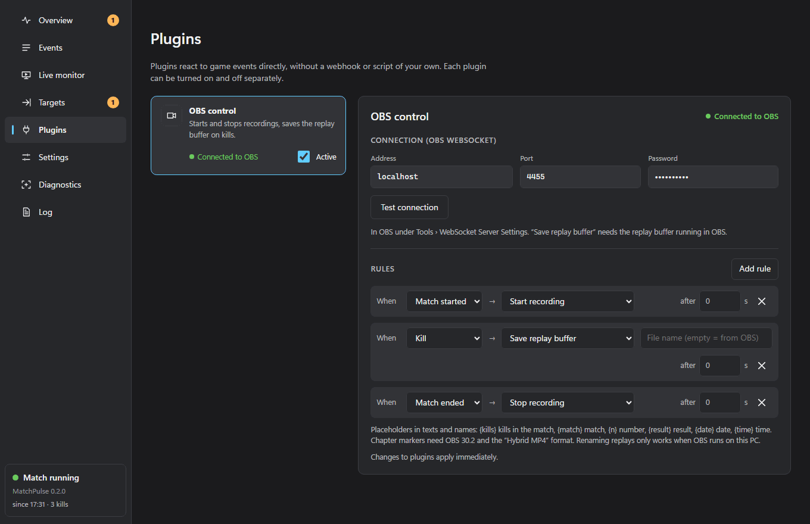
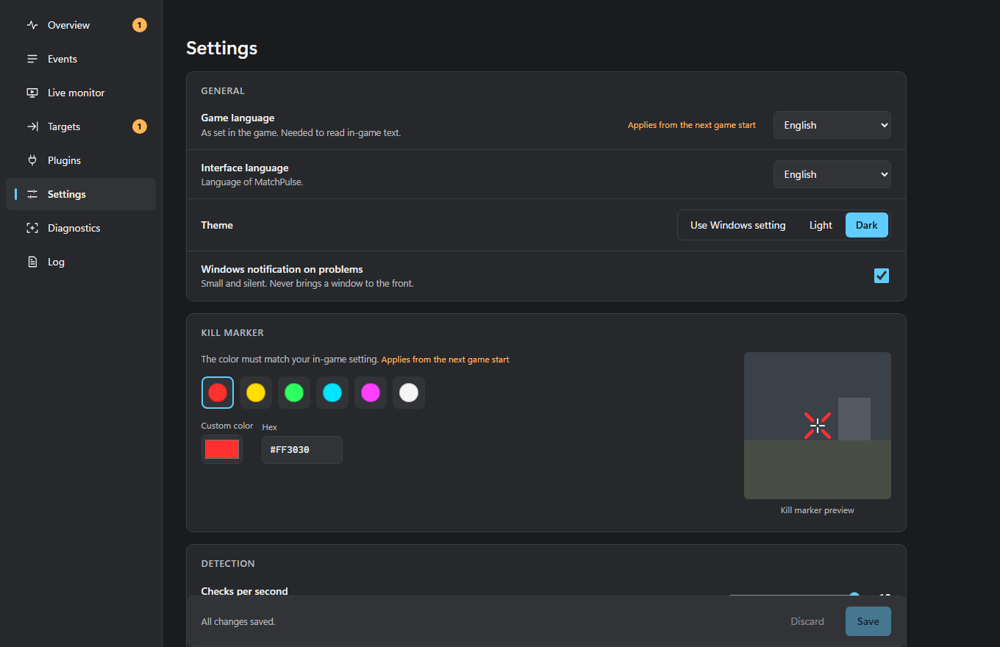

<p align="center">
  
</p>

<h1 align="center">MatchPulse</h1>

<p align="center">
  <b>Turns your Battlefield 6 matches into events — kills, knockdowns, deaths, match start and end — and hands them to OBS, MQTT, webhooks and scripts.</b>
</p>

<p align="center">
  <a href="https://github.com/Diddlik/matchpulse/releases/latest"></a>
  <a href="https://github.com/Diddlik/matchpulse/actions/workflows/build.yml"></a>
  
  <a href="LICENSE"></a>
</p>

<p align="center">
  
</p>

MatchPulse runs quietly in the tray while you play. It watches the game on screen, recognises what happens and sends each moment as a small JSON event. Your recording software saves a clip of every kill, your overlay counts your kills, your script logs your matches — without you pressing a key.

- **Kills** in every mode, also under a Jammer, without counting kills your Squad finishes
- **Knockdowns** and **your death** in REDSEC
- **Matches** in REDSEC and multiplayer rounds (Conquest, Team Deathmatch, Escalation): start, victory, defeat
- **OBS plugin**: start and stop recording, save the replay buffer, chapter markers, scenes, texts, overlays, streaming
- **Highlight video** of every match, cut from the saved replays, and a **stream overlay** (match timer, kill counter, kill animation) as an OBS browser source
- **MQTT** and **Home Assistant** (auto-discovered device with sensors and triggers), Node-RED and other automation tools
- **WLED lights** that flash on a kill, and **sounds** for every event
- **Webhooks and scripts** for anything else
- **Live monitor**: a picture of every kill, also in a window of its own for a second screen
- **Auto-update**, German and English, light and dark

## How it works

<p align="center">
  
</p>

MatchPulse does not touch the game. It only copies small areas of the screen, the way recording software does, and compares them with images of the game's HUD symbols (template matching with OpenCV). It works at any 16:9 resolution and needs no API, no log files and no overlay inside the game.

### Telling your kills apart

<p align="center">
  
</p>

The hit marker X appears on every hit that downs or kills, and the game shows the kill skull also when your Squad finishes an opponent you knocked down. Only your X followed by the skull counts as your kill. The X colour can be changed in the game, so you set the same colour in MatchPulse.

## Screenshots

| Events with their JSON | Targets: webhooks and scripts |
|---|---|
|  |  |
| **OBS plugin rules** | **Settings** |
|  |  |

## Install

1. Download **`MatchPulse-Setup-<version>.exe`** from the [latest release](https://github.com/Diddlik/matchpulse/releases/latest) and run it. No admin rights needed.
   The installer is not signed yet, so Windows SmartScreen may say *unknown publisher*: choose **More info → Run anyway**.
2. MatchPulse starts in the tray. Double-click the icon to open it.
3. In **Settings**, set the **kill marker colour** to the colour of the hit X in your game settings (red by default) and the **game language** (German or English).
4. Start Battlefield 6. The tray icon turns orange when the game runs and green during a match.

Requirements: Windows 10 (1809) or 11, x64, with the Edge WebView2 Runtime (included in Windows 11). Everything else is bundled. A portable zip is attached to every release too.

## Events

Every event is a JSON object, the same for every target:

```json
{
  "type": "kill",
  "matchId": "91fdb6ce4f2a4e0b9c1d7a3e52b8f0aa",
  "sequence": 4,
  "occurredAt": "2026-11-23T20:18:40.312+01:00",
  "data": { "kills": "3" }
}
```

| `type` | When | `data` |
|---|---|---|
| `match_started` | a REDSEC match or a multiplayer round begins | `mode`, `map`: the Match Name read in the lobby (missing when none was read) |
| `kill` | you kill an opponent; in REDSEC already when you knock him down (finishing him later adds no second kill) | `kills`: your kills in this match so far |
| `knockdown` | you knock an opponent down (REDSEC), together with its `kill` | – |
| `death` | you are eliminated and spectate (REDSEC, German game language so far) | – |
| `match_ended` | victory or defeat screen, game closed, or the HUD gone for 2 minutes | `result`: `victory`, `defeat`, `unknown`; `reason`: `end_screen`, `hud_lost`, `game_exited`, `stopped`; `kills` |

`matchId` groups the events of one match; kills in regular multiplayer have `matchId: null`. `sequence` counts the events of a match from 1. `occurredAt` is when the moment was first seen. The **Send test event** button sends `"type": "test"`.

## Targets

**Webhooks** receive every event as an HTTP `POST` with the JSON body.

**Scripts** run once per event with the JSON on stdin. A PowerShell example that keeps a log of your kills:

```powershell
# kills.ps1 — add as target:  pwsh -NoProfile -File C:\Tools\kills.ps1
$e = $input | Out-String | ConvertFrom-Json
if ($e.type -eq 'kill') { "$($e.occurredAt)  kill #$($e.data.kills)" | Add-Content "$env:USERPROFILE\kills.txt" }
```

A failing, slow or hanging target never holds up detection or the other targets; its error shows on the Targets page.

## MQTT plugin

Under **Plugins → MQTT**, enter your broker (address, port, optional TLS, user name and password) and a topic prefix. MatchPulse then publishes:

| Topic | Payload |
|---|---|
| `matchpulse/events/<type>` | every event as JSON, e.g. `matchpulse/events/kill` — subscribe to `matchpulse/events/+` for all |
| `matchpulse/status` | `online` or `offline`, retained; the broker sets `offline` by Last Will if MatchPulse stops unexpectedly |
| `matchpulse/state/match` · `kills` · `knockdowns` · `deaths` · `last_event` | the current match, retained: `ON`/`OFF`, counts in the match, the last event type |

QoS 0, 1 or 2 can be chosen.

## Home Assistant

Turn on **Plugins → Home Assistant** (with the MQTT plugin pointing at your Home Assistant's broker, e.g. the Mosquitto add-on). Through MQTT discovery a device **MatchPulse** appears in Home Assistant by itself, with:

- **Sensors:** match running, kills, knockdowns and deaths in the match, last event, plus availability
- **Device triggers** for automations: match started, kill, knockdown, death, match ended

So an automation like *"when MatchPulse kill → flash the desk light red"* or *"when MatchPulse match started → turn off the doorbell chime"* takes a few clicks. Turning the plugin off removes the device again.

## OBS plugin

MatchPulse controls OBS directly over **OBS WebSocket** (built into OBS 28 and later). In OBS, turn on *Tools → WebSocket Server Settings*, then enter address, port and password under **Plugins** in MatchPulse and add rules *"when event → action"*:

| Action | Typical use |
|---|---|
| Save replay buffer *(optional file name)* | a clip of every kill, e.g. named `{date}_{match}_Kill-{kills}` |
| Start / stop replay buffer, start / stop / pause / resume recording | record whole matches |
| Split recording into a new file | one file per match |
| Add chapter marker | jump to every kill in one long recording (OBS 30.2+, Hybrid MP4) |
| Switch scene, set text, show a source for N seconds | overlays: kill counter, kill animation |
| Start / stop stream | |

Every rule can wait a few seconds first — for example, save the replay buffer 3 s after a kill, so the moment after it is in the clip. Placeholders: `{kills}`, `{match}`, `{n}`, `{result}`, `{mode}`, `{map}`, `{date}`, `{time}`.

**Match names.** Before a match, MatchPulse reads the mode and map from the lobby (top left) with the OCR built into Windows, in the game language. New names appear under Settings → Match names, one per line; correct a misreading there, and later reads that are nearly the same are replaced by your spelling.

**Highlight video**: turn on *Create a highlight video after each match* in the OBS plugin. With a rule like *kill → save replay buffer*, MatchPulse takes the last N seconds (default 10) of every replay saved in the match and joins them into `Highlights <date> <time>` in the replay folder. Replays that overlap are used once. It needs [ffmpeg](https://ffmpeg.org) on the PATH (`winget install Gyan.FFmpeg`) and OBS on the same PC. Cuts are made without re-encoding, so they fall on keyframes.

## Stream overlay

Turn on **Plugins → Stream overlay** and add `http://localhost:4466/` in OBS as a *Browser* source (for example 1920 × 1080). The page has a transparent background and shows the match timer, the kill count and a big *KILL* pop on every kill. Add `?color=00ff88` to change the accent colour. The port can be changed in the plugin.

## WLED and sound

**WLED** — under **Plugins → WLED**, add one or more WLED controllers (name and address). Each controller has its own rules: *flash* a colour (solid, blink or strobe) for a moment, *load a preset*, *set a colour*, or turn the lights *on* or *off*. After a flash MatchPulse puts the lights back the way they were; several kills in a row restore the state from before the first.

**Sound** — under **Plugins → Sound**, pick a built-in sound (ding, double ding, low tone, fanfare) or your own WAV or MP3 file for any event, with its own volume. Sounds play on the Windows default output device without holding anything up; ▶ next to each rule plays it as a test.

## More

- **On/off with a hotkey** — **Ctrl+Alt+M** (changeable in Settings) pauses MatchPulse and turns it back on from anywhere, also in the game; a short notice shows above all windows. The same switch is in Settings and the tray menu. Paused means no capture and no events.
- **Live monitor** — with it turned on, MatchPulse saves a picture of the screen at every kill and shows it at once, also in a window of its own that never takes the focus from the game.
- **Diagnostic mode** — when a kill seems missing, MatchPulse saves a picture of every unclear moment (a skull without an X, an X without a skull) with the kill feed, so the cause can be found.
- **Updates** — MatchPulse checks the releases at start and once a day, verifies the download's SHA-256 and installs it silently, never while the game runs. Both can be turned off.
- **Privacy** — MatchPulse sends nothing anywhere except to the targets you add, and reads only `github.com/Diddlik/matchpulse/releases` for updates. Settings and pictures stay in `%APPDATA%\MatchPulse`.

## Limits

- REDSEC: matches, kills, knockdowns, deaths. Regular multiplayer: rounds (start, victory, defeat) and kills; knockdowns and deaths follow.
- 16:9 screens; ultrawide (21:9) is planned.
- Death detection needs the German game language until an English *Spectating* image is added.
- A hit marker that shows for a single frame can be missed at 10 checks per second.

## Build from source

.NET SDK 11, Windows.

```powershell
dotnet test
dotnet run --project src/MatchPulse -- --show                 # tray app with the window open
dotnet run --project src/MatchPulse -- live                   # detection in the terminal
dotnet run --project src/MatchPulse -- replay <video.mkv>     # detection on a recording
```

The window is a plain HTML page in `src/MatchPulse/ui/`; open `index.html` in a browser to work on it with demo data. The fixture clips (`fixtures/clips/*.mkv`) are cut from private recordings and are not in this repository, only their `.expected.json` files; without them run `dotnet test --filter "FullyQualifiedName!~FixtureClipTests"`.

Releases are built by GitHub Actions when a tag `v<version>` is pushed: tests, self-contained publish, installer (Inno Setup, `installer/MatchPulse.iss`), portable zip and `latest.json` for the updater.

Design notes: [`GLOSSARY.md`](GLOSSARY.md), [`docs/adr/`](docs/adr), [`docs/ui-brief.md`](docs/ui-brief.md).

## Licence

MIT, see [`LICENSE`](LICENSE). Battlefield is a trademark of Electronic Arts. MatchPulse is not affiliated with or endorsed by EA.
